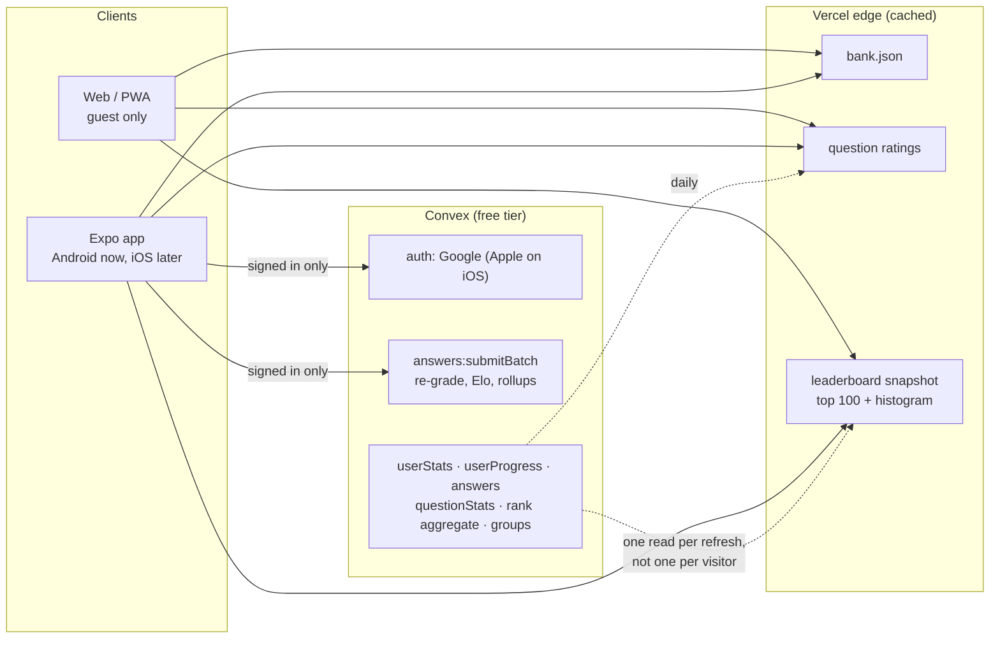

# Architecture: decision record

Status: **decided** on 2026-11-10. This supersedes the options in #47 and the
open checklist in #34. The issues that implement it link back here.

This file holds the *why*. Issues hold the *what*. If the two disagree, fix the
issue or reopen the decision here. Do not let an issue quietly change it.

## Goals

These come from the owner and drive every decision below.

1. **Free to run.** There is no revenue, and there may never be. The whole
   system has to fit Convex's free tier and Vercel Hobby, with headroom for a
   viral spike.
2. **Simple.** One way to play and as few moving parts as possible. Remove
   things rather than add them.
3. **Professional.** Fast, instant feedback, works offline, no broken states.
   It goes on a CV and gets promoted on social media, so it has to hold up.
4. **The web is the entry point, the app is the product.** Most people only
   click a link: from a friend, the CV or a social post. They should get a good
   game straight away, with no download and no login. People who want to keep
   their progress and compete install the app.
5. **Built to spread.** A leaderboard to argue over ("I know the most about
   AI"). Later, friend groups: get invited, see your position in each group,
   be #1 in two groups and #5 in a third.

## The shape in one paragraph

Questions are a static file. Every client draws, grades and calculates Elo on
the device, so feedback is instant and offline play is the same code path as
online play. **The web is guest-only**: it plays, keeps progress in the
browser, and shows where you *would* rank. **The Expo app is the ranked
product**: Google sign-in, answers synced in batches, server-side Elo,
leaderboard and groups. Convex is only called by signed-in app players.
Everything public (bank, question ratings, leaderboard) is served as cached
snapshots from the Vercel edge, so a spike of guests costs Convex nothing.

## Decisions

| # | Decision | What we give up |
|---|---|---|
| 1 | Keep **Convex**, on the free tier | Nothing yet. Leaving later means an export script, and the backend is open source |
| 2 | **Static bank**; draw, grade and Elo **on the device** | Hiding answers from players, which was never possible once offline play shipped |
| 3 | **Web is guest-only**: no login, nothing uploaded | A web player's progress stays in that browser |
| 4 | **The Expo app is the ranked product** (Android first, iOS later) | Two UIs, but the web one is deliberately small |
| 5 | **Google sign-in only** in the app (plus Apple when iOS ships) | Email and password, along with its reset problem |
| 6 | **Store answers, never scan them during play.** Batched submits, rollups | Unlimited raw history if storage gets tight |
| 7 | **Questions earn ratings from play** | Authored difficulty becomes only the starting value |
| 8 | **Leaderboard**: opt-in, signed-in, minimum answers, exact rank | Proof against a determined cheater (the inspiration app accepts this too) |
| 9 | **Friend groups**: designed now, built after the leaderboard | Nothing |

### 1. Keep Convex

Convex already gives us auth, a transactional Elo update, the replayable
outbox contract, rate limits and the deletion cascade, all tested. The
alternatives each mean rewriting about 2k lines of backend for zero measured
pressure:

- Supabase/Postgres would gain SQL for analytics, but means migrating auth and
  losing reactivity.
- Cloudflare Workers + D1 is cheapest at scale, but we would rebuild auth,
  rate limits and replay ourselves.

Free tier (convex.dev/pricing, checked 2026-11-10): 1M function calls,
0.5 GB storage, 1 GB database I/O and 1 GB egress a month. Past that, Pro is
$25/developer/month with 25M calls and 50 GB. Per-transaction limits: 16 MiB
read, 32k documents scanned, 4,096 index ranges, 1 s of execution.

### 2. Static bank, played on the device

Before this decision, questions reached a player in four ways: the Convex
draw, the answer-free `drawForPlay`, the `reveal` mutation, and the static
`bank.json` (precached by the web, committed into the app). The answers were
already public in `bank.json` and in the APK, so the server `reveal` added in
#58 protected nothing. It also cost a round trip on every answer, which is the
"Checking answer…" pause in #91.

Now:

- Git (`content/questions/*.json`) stays the source of truth. The build emits
  `bank.json`, served from the edge and versioned by content hash. The app
  ships a copy and fetches a newer one when online.
- The Convex `questions` table stays, but only so the server can re-grade
  submitted answers, and for admin and publishing.
- Clients draw with the shared `weightedSample`, grade locally and show the
  verdict at once. Options are shuffled per presentation (#54).
- Removed: `reveal`, `draw`, `drawForPlay`, the public `list`, the reactive
  `counts`, and the per-answer redraw.
- If a question is corrected after a client cached it, the server's verdict
  wins on submit and the client reconciles, as it already does for rating.

Size is not a concern. The whole bank is 1,035 questions, 1.06 MB raw and
235 KB gzipped. At 2,100 questions (#22) it is about 480 KB. Shard by category
if it ever passes a few MB. The inspiration app ships about 16k questions per
language inside the APK.

### 3. The web is guest-only

The web is where people arrive, so it has to be good, but it is not where
ranking happens.

- Full play, local progress, local Elo, a local profile and stats.
- **"You'd be #212."** The local Elo is placed against the cached leaderboard
  snapshot. The player is not on the board, so editing localStorage only fools
  themselves.
- The leaderboard and group pages can be viewed. Ranking or joining a group
  says "get the app".
- **No sign-in, no Convex calls.** This removes the guest-claim path (#44),
  the multi-tab sign-out edge cases (#89) and web account management. The
  privacy page stays and says what the web keeps (only the browser's own
  storage).

Encrypting localStorage would not help. The key ships in the page, so anyone
can decrypt, edit and re-encrypt. It does not matter here, because nothing on
the web is uploaded or ranked.

Rule: **no web code path may write ranked state.** If that ever changes, this
decision is reopened first.

### 4. The Expo app is the ranked product

The app is where real players stay, so it should feel native: real native
components, haptics, and the OS sign-in sheet. Expo already exists
(`apps/mobile`, #45), builds for iOS later from the same code (#19), and
supports native Google sign-in. Capacitor (wrapping the web) was considered
when the web was going to be the main product, and rejected once the app
became the product.

- Shared logic (Elo, grading, the draw, the outbox, the bank format) lives in
  one place and both apps import it. Screens are per surface.
- The web is intentionally a smaller surface, so "parity" means the shared
  core behaves the same, not that both UIs have every feature.
- The bank inside the app is encoded at rest, so answers are not readable at a
  glance. This only adds friction, as section 8 explains.
- Costs: a Google Play developer account is a one-time $25. iOS needs the
  Apple Developer Program at $99 a year. It waits until the numbers justify it.

### 5. Google sign-in only

One tap, no passwords, no reset or verification emails to build, and one
account per Google identity, which raises the cost of fake accounts. Apple
sign-in becomes mandatory once iOS offers Google (App Store guideline 4.8).

Risk: the documented Convex Auth Expo path uses an in-app browser for OAuth.
Native Google sign-in (`@react-native-google-signin/google-signin`, which
Expo now recommends) needs either a supported Convex Auth flow or a custom
provider that verifies the Google ID token on the server. **Prove this first.**
It is the riskiest step on the roadmap.

Existing email/password accounts: hide password signup, keep the provider long
enough to link or migrate the few existing accounts, then remove it.

### 6. Per-user data: store answers, read rollups

Should the full list of answers per user live in the database? **Yes, as an
append-only log that nothing reads during play.** It is what lets the server
dedupe replays, audit a suspicious rating, calibrate question ratings and
recompute everything if the Elo formula changes.

What gets read:

| Table | Shape | Read by |
|---|---|---|
| `userStats` | 1 small doc: rating, counts, streak, per-category | profile, leaderboard index, rank aggregate |
| `userProgress` | done question ids, downsampled rating series, recent answers | a new device (once), profile |
| `answers` | append-only, tiny rows, written in batches | dedupe, audits, recalculation, never on the hot path |
| `questionStats` | per question: attempts, correct, rating | the daily ratings snapshot |

Rules:

- Answers go up as one `submitBatch` per roughly 10 answers (or when the app
  goes to the background), not one mutation each. The server re-grades every
  pick and computes Elo sequentially in one transaction.
- No reactive query over a user's history. No `paginate()` loops in a function
  (this was the root of #64 and #65).
- Keep documents small and rewrite them rarely. Database I/O, not calls, is
  the meter we hit first on the free tier.
- Retention trigger: if storage passes 60% of the tier, prune raw answers to
  the last 200 per user. Rollups keep everything the UI shows.

### 7. Questions earn ratings from play

The inspiration app gives every question its own Elo (665–2600, average about
1620) and updates it from answers. Ours are hand-set: published difficulty is
d1 242 · d2 485 · d3 268 · d4 39 · d5 1. That is why the ladder has no top
(#66): a perfect player stalls around 1500–1650.

`submitBatch` updates `questionStats` alongside the player. A daily snapshot
publishes the ratings next to the bank, and the draw and the local Elo use
them. Authored difficulty becomes the prior for new questions. This absorbs
#33 and #66.

### 8. Leaderboard and integrity

Be honest about what can be protected. Answers have to be on the device for
offline play, so a determined player can always pick the right one.

| Threat | Web | App |
|---|---|---|
| Looks up the answer mid-game | Easy (dev tools) | Hard (unpack the app) |
| Edits stored rating | Pointless: never uploaded | Pointless: the server recomputes it |
| Scripts our API directly | Possible | **Equally possible.** The inspiration app's endpoints were plain strings in its APK |

The phone stops casual cheating. The server stops the rest:

- Signed-in Google accounts only, at least 50 server-recorded answers to
  appear, and opt-in visibility (#8).
- Rate limits (already built in #59).
- Plausibility flags: answering faster than anyone could read, or near-perfect
  accuracy on top-rated questions. Flagged players are hidden pending review.
  The admin can ban.
- Optional, only if cheating becomes real: **Play Integrity** attests that
  requests come from our genuine app on a genuine device. The default free
  quota is 10k requests per app per day, so check it once per session, not
  per answer.

Display:

- A public top 100, served as a cached snapshot (refreshed every few minutes,
  one Convex read per refresh).
- Exact rank for any signed-in player through the official
  `@convex-dev/aggregate` component (O(log n), a small extra write per batch).
- A rating histogram doc maintained in `submitBatch` powers percentiles and
  the web's "you'd be #X".

### 9. Friend groups

Designed now so nothing blocks them, built after the global leaderboard.

- `groups` (name, owner, invite code) and `groupMembers` (group, user).
- A group board reads only its members' `userStats`. Groups are small, so this
  is cheap and needs no aggregate.
- The invite link is the viral loop. A friend opens it on the web, previews
  the group board and plays as a guest straight away, then installs the app to
  join.
- Later candidates on the same tables: weekly challenge (#9), async matches
  (#13).

## Free-tier budget (estimates)

Assumptions: a signed-in session is 20 answers, about 5 function calls with
batching, and about 20 KB of database I/O. A stored answer is about 600 B
including indexes. Guests make **zero** Convex calls.

| Month | Calls (1M) | I/O (1 GB) | Storage (0.5 GB) |
|---|---|---|---|
| Normal: 1,000 guest + 100 app sessions a day, about 300 accounts | ~3% | ~13% | ~15% |
| Viral: 10,000 guest + 1,000 app sessions a day, about 3,000 accounts | ~16% | ~67% | ~70%, prune |

These are estimates from published limits and our document sizes. Measure
with the Convex usage dashboard after the batching work lands, and update this
table.

## Research notes

### The inspiration app

Endless Quiz (`com.timleg.quiz`, v1.0.3.5.0). Inspected for structure only,
on 2026-11-10. Nothing was decrypted or copied.

- A native Kotlin Android app. The bank is a set of bundled SQLite files, one
  per language, 1–7 MB each. English has about 16k questions, and every
  question field is encrypted at rest.
- Grading and Elo run on the device. A local `Log` table records old and new
  player rating, the question's rating change, the K-factor (20) and a
  `sentToServer` flag, which is an outbox like ours.
- Questions carry their own `rating` and `percent` correct, updated from play
  (`rating_update.php`) and refreshed down (`fetch_fresh_ratings.php`).
- The server is a few PHP endpoints: account creation, incremental question
  updates, rating stats (percentile), high scores, weekly challenge, friends
  and multiplayer. Identity is Google Play Games. Ads fund it.
- Weekly-challenge questions are pre-assigned in the bank (a
  `weeklyChallengeDate` column).
- The web version (`endquiz.com/quiz.php`) has no login. It fetches batches
  that include the correct answer, grades in the browser, keeps Elo in a
  cookie (starting at 800) and shuffles options on the device. It is a teaser
  for the app.

Takeaways we adopted: ship the bank to the device, grade locally, rate
questions from play, and accept casual integrity on the leaderboard. Where we
differ: server-side Elo for ranked players, and server-side checks instead of
trusting the uploaded rating.

### This codebase before the decision (2026-11-10)

- Four question delivery paths, as described in section 2.
- `myCompleted` and `stats.history` scanned a user's whole event history
  inside reactive queries that re-ran after every answer (#64), using
  `paginate()` loops (#65).
- Web sign-in never ran `claimProgress` or `ensureProfile`, because
  `Account` was no longer rendered (#44). The app did run them.
- Two full UIs kept in step by hand (`docs/native-parity.md`, #50, #51).

### Rejected alternatives

- **Full web accounts and a ranked web.** It means more code (claim, sync,
  multi-tab, deletion on two surfaces), and the cheating surface is larger
  where casual cheating is easiest.
- **Capacitor wrap instead of Expo.** One codebase, but a website-in-a-frame
  feel and Google blocking embedded-webview sign-in. It made sense only while
  the web was the main product.
- **Local-first everywhere with no server Elo.** No leaderboard you can trust,
  and merging divergent Elo chains needs the events anyway.
- **Postgres or dual writes for the event log.** Two datastores for no
  measured pressure, and dual writes fork a sequential Elo chain.
- **Server-graded reveal (#58) as the trust model.** It cannot hold once the
  bank is offline, and it breaks instant feedback.
- **Encrypting local state as anti-cheat.** The key ships with the client, so
  it only adds friction.

## Invariants

Code review should enforce these.

1. **Guests make zero Convex calls.** Public data comes from edge snapshots.
2. **No web code path writes ranked state.**
3. **Nothing scans `answers` during play or on profile views.** Per-user reads
   come from rollups.
4. **The server re-grades every submitted pick.** A client's rating or verdict
   is never trusted.
5. **Feedback is local and instant.** No network round trip between a tap and
   the verdict.
6. **One shared core for game logic.** A rule (Elo, draw, grading, outbox)
   exists once and both apps import it.

## Roadmap

The [Endless AI Roadmap](https://github.com/users/miguelcorderocollar/projects/8)
project tracks the implementation. Each work package is an `epic` issue with
sub-issues that carry their own acceptance criteria and validation steps. See
`AGENTS.md` → *Working the roadmap*.

| Phase | Work package | Issue |
|---|---|---|
| A | WP0 · Safety net and operations | #94 |
| A | WP1 · Play on the device: one play path, instant feedback | #95 |
| A | WP2 · Answer sync v2: batched submits, rollups, no history scans | #96 |
| A (spike) → B | WP3 · Google sign-in for the app | #97 |
| B | WP4 · The web becomes guest-only | #98 |
| B | WP5 · Questions earn ratings from play | #99 |
| B | WP6 · Leaderboard v1 | #8 |
| B | WP7 · Ship the Android app | #18 |
| C | WP8 · Friend groups | #100 |

Closed as superseded by this decision: #34, #44, #47, #50, #51, #56, #89.

## Revisit when

- Convex usage passes 60% of any free-tier meter: batch harder, prune, or move
  to Pro.
- Cheating shows up on the leaderboard: turn on Play Integrity and tighten the
  flags.
- Few web players install the app: reconsider letting the web sign in,
  unranked.
- The bank passes a few MB: shard `bank.json` by category.
- The Android numbers justify it: iOS through Expo, with Apple sign-in (#19).
